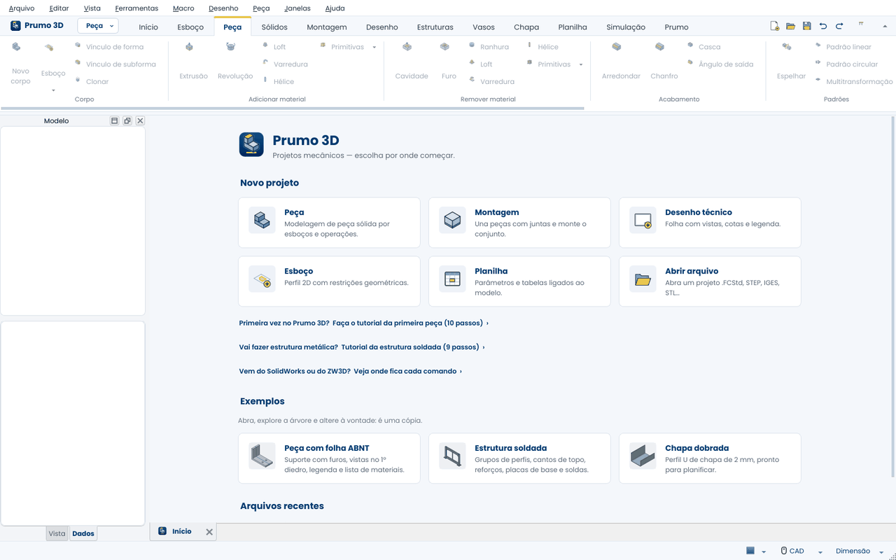
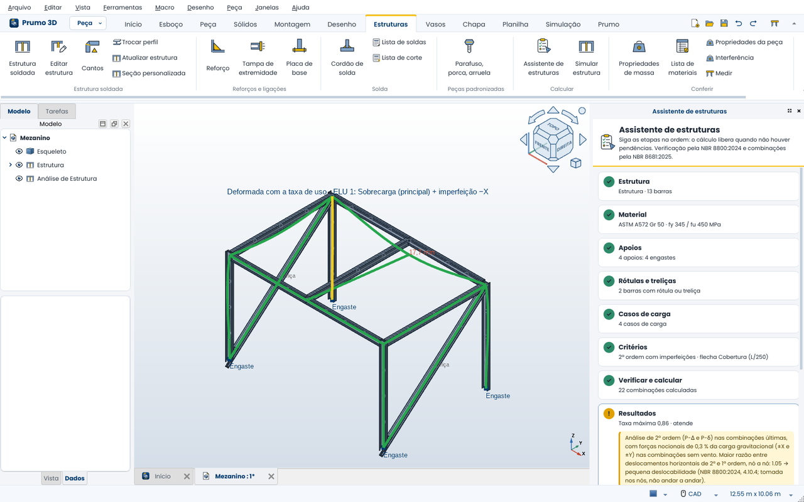
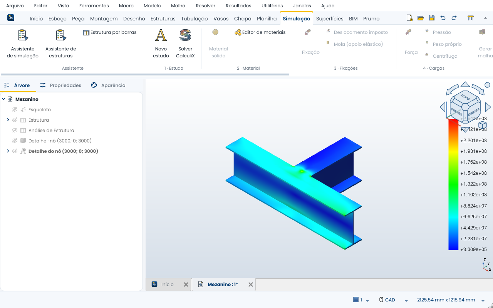
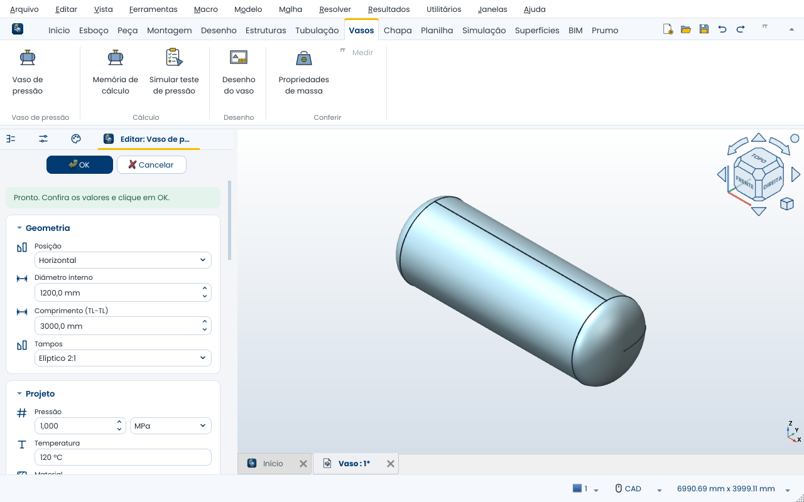
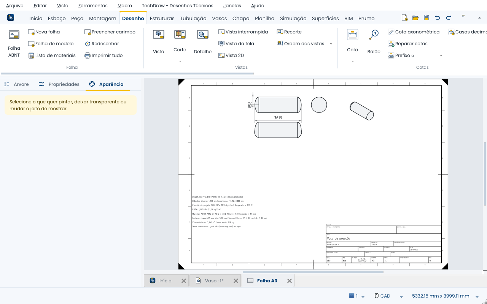
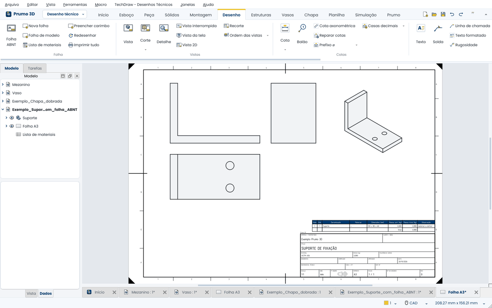
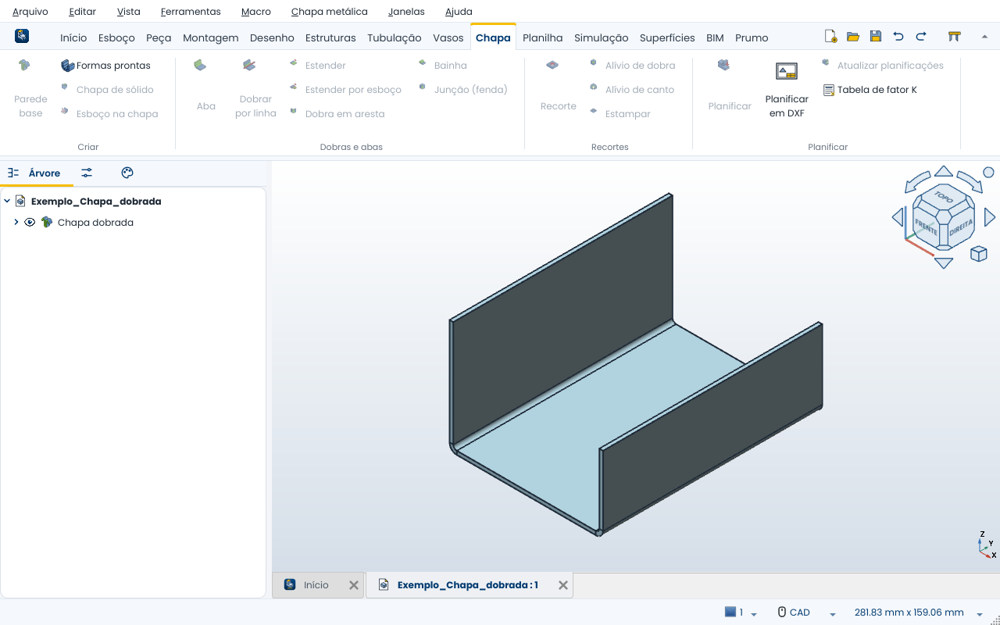

# Prumo 3D

### Modelagem 3D paramétrica em português

[Baixar](https://github.com/prumo3d/prumo3d/releases/latest) •
[Novidades](NOVIDADES.md) •
[Problemas e sugestões](https://github.com/prumo3d/prumo3d/issues) •
[Como contribuir](CONTRIBUTING.md) •
[Documentação do FreeCAD](https://wiki.freecad.org)

O Prumo 3D é um modelador 3D paramétrico livre e gratuito, em português, para projeto mecânico:
peças, montagens, desenho técnico no padrão ABNT, estruturas metálicas calculadas pelas normas
brasileiras, vasos de pressão e simulação por elementos finitos. É baseado no
[FreeCAD](https://www.freecad.org) e mantém tudo o que ele oferece, com uma interface reorganizada e
ferramentas que encurtam o caminho entre a ideia e o desenho ou a simulação.

> [!NOTE]
> O Prumo 3D não é um projeto oficial do FreeCAD nem é mantido pela comunidade do FreeCAD.

Novidades
---------

**Versão atual: 0.8.1 beta** (24/10/2026)

- **Painéis dos comandos em cartões:** Extrusão, Cavidade, Furo, Revolução, Ranhura, Arredondar, Chanfro,
  Padrão linear, Padrão circular e Espelhar, com botões de ícone, chaves liga/desliga e campos com
  unidade; o formulário do FreeCAD continua a um clique.
- **Assistentes, tutorial e guia como abas do painel lateral**, e mais telas no padrão novo.

Na 0.6.0: painel lateral novo (Árvore, Propriedades, Aparência), aba do esboço com relações e
atualização opcional pelo Ajuda → Sobre. Na 0.5.0: Esboço 3D com restrições. Na 0.3.0: **Tubulação**
de PVC soldável.

[Todas as novidades, versão por versão](NOVIDADES.md) • [Baixar a versão atual](https://github.com/prumo3d/prumo3d/releases/latest)

O que o Prumo 3D tem de diferente
---------------------------------

### Estruturas metálicas calculadas pelas normas brasileiras

Desenhe o esqueleto, escolha os perfis (W, HP, U, I, cantoneiras, tubos e metalon de catálogos
nacionais) e calcule a estrutura por barras no próprio modelo: apoios clicando nos nós, rótulas e
treliças, casos de carga e combinações da **ABNT NBR 8681:2025**, análise de 2ª ordem com
imperfeições e verificação de cada barra pela **ABNT NBR 8800:2024**. A taxa de uso aparece em cores
na deformada, e a memória de cálculo sai em PDF.

O **Assistente de estruturas** conduz o cálculo em etapas e só libera quando não há pendências: carga
com valor zero, apoio fora de nó, barra que sumiu do desenho, falta de caso de vento, deslocabilidade
alta.

### Detalhe da ligação por elementos finitos

Um clique num nó recorta a ligação, aplica nos cortes os esforços da análise por barras e calcula as
tensões no sólido (CalculiX). As soldas de filete (perna necessária, mínima e máxima) e os chumbadores
da placa de base são verificados pela NBR 8800:2024. O Assistente de simulação acompanha malha,
convergência e relatório.

### Vasos de pressão do formulário ao desenho

Aba própria com formulário e prévia ao vivo: casco, tampos (elíptico 2:1, torisférico, hemisférico),
material, corrosão, bocais e suportes (selas, saia ou pernas). Espessuras e PMTA pelo ASME VIII
Div. 1, pressão de teste hidrostático ou pneumático, teste simulado por elementos finitos de casca e
folha A3 com vistas cotadas e tabela de dados de projeto.

| Formulário com prévia | Desenho gerado |
|---|---|
|  |  |

### Desenho técnico no padrão ABNT e chapa metálica

Folhas A0 a A4 com legenda brasileira (responsável técnico, CREA/CFT, ART, 1º diedro), lista de
materiais ligada ao modelo, e chapa metálica com fator K por material e planificação em DXF num
clique.

| Folha ABNT | Chapa dobrada |
|---|---|
|  |  |

### Em resumo

| | Prumo 3D |
|---|---|
| Idioma | Tudo em português, inclusive propriedades e listas |
| Interface | Faixa de ferramentas por abas, painéis visuais, tela inicial, tutoriais e guia para quem vem do SolidWorks ou ZW3D |
| Estruturas | Perfis brasileiros, cantos, reforços, soldas, lista de corte, cálculo pela NBR 8800:2024 e NBR 8681:2025 |
| Simulação | Assistentes passo a passo para elementos finitos e para estruturas, com pendências e relatório em PDF |
| Vasos | Formulário ASME VIII-1, teste de pressão, desenho cotado |
| Desenho | Folhas ABNT com legenda brasileira e lista de materiais |
| Materiais | Aços e ligas usados no Brasil, com norma e fonte em cada um |
| Base | FreeCAD 1.1: OpenCASCADE, Coin3D, Qt e Python, com tudo o que o FreeCAD oferece |

> [!IMPORTANT]
> Versão beta, para testar. Os cálculos ajudam no projeto, mas não substituem a análise e a
> responsabilidade técnica de um profissional habilitado (com ART). Itens fora do escopo de cada
> verificação aparecem como aviso no próprio programa e na memória de cálculo.

Todos os recursos
-----------------

* **Tudo em português** Menus, painéis, nomes de propriedades e opções de listas traduzidos, inclusive termos
  que a tradução oficial do FreeCAD ainda não cobre.

* **Faixa de ferramentas** Os comandos principais organizados em abas (Início, Esboço, Peça, Sólidos,
  Montagem, Desenho, Estruturas, Chapa, Planilha, Simulação e Prumo), com ícones grandes e rótulos claros. A aba Esboço aparece
  sozinha ao editar um esboço.

* **Tela inicial** Começa uma peça, montagem, desenho técnico, esboço ou planilha com um clique e mostra os
  arquivos recentes.

* **Assistente de simulação** Análise por elementos finitos em etapas guiadas: peça, material, fixações,
  cargas, malha, verificação de pendências, resultados e relatório em PDF.

* **Assistente de estruturas** Cálculo por barras em etapas guiadas: estrutura, material, apoios (inclusive
  molas), rótulas, treliças e contraventamentos só de tração, casos de carga, critérios, conferência de
  pendências, resultados, detalhe das ligações e memória de cálculo. Também calcula as frequências
  naturais e grava vídeo do comportamento da estrutura.

* **Seção personalizada** Um esboço fechado vira perfil da estrutura, com centro de cisalhamento, J e Cw
  calculados por elementos finitos na própria seção e verificação completa pela NBR 8800:2024.

* **Vasos de pressão** Formulário com prévia, espessuras e PMTA (ASME VIII-1), teste de pressão simulado
  por elementos finitos de casca e desenho cotado em folha A3.

* **Biblioteca de materiais** Aços estruturais, inoxidáveis, para vasos de pressão, para construção mecânica,
  tubos, forjados e alumínio, com as especificações usadas no Brasil.

* **Tutoriais interativos** "Primeira peça" (esboço, cotas, extrusão, furo, arredondamento e salvar) e
  "Estrutura soldada" (esqueleto, grupos de perfis, cantos, reforço, solda e lista de corte). O painel
  acompanha o que você faz na tela e marca cada passo sozinho.

* **Guia ilustrado** Ao editar extrusão, cavidade, furo, arredondamento, chanfro, padrões e outras operações,
  o painel de tarefas mostra um desenho do que a operação faz no modo escolhido. O diálogo Cantos da
  estrutura soldada mostra o desenho de cada tratamento (meia-esquadria, de topo, recorte pelo contorno).

* **Árvore do modelo** Se o painel da árvore for fechado sem querer, o botão Início → Árvore do modelo
  traz de volta. Objetos novos ganham nome em português (Extrusão, Cavidade, Corpo).

* **Painéis visuais e seleção nos dois sentidos** Painéis de tarefa no estilo PropertyManager (mensagem,
  seções com ícone, dica por campo) e caixas de seleção que aceitam selecionar antes ou depois de chamar
  o comando; booleanas e comandos do Prumo pedem a seleção quando chamados sem ela.

* **Propriedades da peça, variantes e modelos com regras** Código/denominação/revisão/material na lista
  de materiais e na legenda (que acompanha a peça); tabela de variantes P/M/G ligada às cotas; placa
  com furos, flange, suporte em L e eixo escalonado gerados por formulário, com regras de projeto.

* **Chapa e montagem** Fator K por material e planificação em DXF; verificar interferência; copiar
  projeto (Pack and Go). Guia "vindo do SolidWorks / ZW3D" com a equivalência dos comandos.

* **Tubulação** Tubos e conexões de PVC soldável sobre o traçado: joelhos, tês, reduções, cruzetas,
  caps e registros escolhidos pelo catálogo do fabricante, tubo cortado descontando as bolsas, lista de
  corte em barras e itens na lista de materiais.

* **Esboço 3D** Linhas no espaço, ponto a ponto: clique na vista (Tab troca o plano XY, YZ, ZX) ou
  digite as coordenadas; encaixa em vértices, faz ramais e curvas nos cantos. Restrições ao longo de
  X/Y/Z, cotas, paralelas, perpendiculares e linhas de construção. Vira esqueleto da estrutura soldada ou
  caminho de tubo e varredura.

* **Esboço com ímãs e inferência** Ao desenhar, aparecem pontos-ímã nos quadrantes de círculos e arcos, no
  meio das linhas e nas interseções; o cursor é atraído e o ponto já recebe as restrições. Linhas tracejadas
  de inferência alinham o cursor na horizontal ou na vertical com pontos existentes.

* **Régua de histórico** Uma régua amarela na própria árvore do modelo, logo abaixo da última operação do
  corpo: arraste para cima e o modelo recua até ali (as operações de baixo ficam esmaecidas); as novas
  operações entram no ponto da régua. Duplo clique volta ao modelo completo.

* **Conferência do esboço** Ao concluir um esboço, o Prumo avisa de pontas quase encostadas, pontas soltas
  num perfil e elementos de tamanho zero, e corrige com um clique (o problema do "esboço aberto").

* **Cotas na tela** Duplo clique numa face mostra as cotas da operação que a criou (comprimento da extrusão,
  raio do arredondamento, diâmetro do furo, cotas do esboço) para mudar o valor ali mesmo.

* **Menu de contexto pela seleção** O botão direito oferece o que faz sentido para o que está selecionado:
  esboço na face, extrudar, cavidade, arredondar, chanfro, medir e propriedades de massa.

* **Propriedades de massa e lista de materiais** Massa, centro de gravidade e momentos de inércia com o
  material de cada peça; lista de materiais da montagem em planilha e como tabela na folha de desenho.

* **Folhas ABNT** Folhas A0 a A4 no padrão da ABNT NBR 16752 (e no da NBR 10068), com legenda brasileira
  (responsável técnico, CREA/CFT, ART, 1º diedro) preenchida a partir do documento e vistas no 1º diedro.

* **Estruturas soldadas** Barras de perfis brasileiros (W, HP, U, I, cantoneiras, tubos e metalon, de
  catálogos de fabricantes) sobre um esqueleto de linhas, em grupos (perfil, giro, ponto de fixação e
  espelhamento por grupo). Cantos em meia-esquadria ou de topo (escolhendo qual barra passa), corte reto ou
  recorte pelo contorno nas ligações em T, nós com três ou mais barras, e cantos parecidos tratados de uma
  vez. Reforços (mão-francesa), tampas de tubo, placas de base com furação, cordões de solda com perna,
  processo e eletrodo, lista de corte e lista de soldas.

* **Chapa metálica** Parede base, abas, dobras, recortes, alívios e planificação (bancada SheetMetal embutida).

* **Peças padronizadas** Parafusos, porcas e arruelas métricas para inserir no modelo.

* **Visual próprio** Tema claro, ícones redesenhados e tela de abertura do Prumo 3D.

* **Testes automatizados** Um conjunto de testes confere tradução, aparência, assistente de simulação e
  comportamento da interface a cada versão.

* **Base sólida** Tudo o que o FreeCAD oferece continua disponível: núcleo geométrico OpenCASCADE, cena 3D
  Coin3D, interface Qt e programação em Python.

Instalação
----------

Baixe a versão mais recente na [página de versões](https://github.com/prumo3d/prumo3d/releases/latest):

| Sistema | Arquivo | Como usar |
|---|---|---|
| Windows 10/11 (64 bits) | `Prumo3D_…-installer.exe` | Rode o instalador. |
| Windows (portátil) | `Prumo3D_…-Windows-….7z` | Descompacte e abra `bin\Prumo3D.exe`. |
| Linux (64 bits) | `Prumo3D_…-Linux-….AppImage` | Marque como executável e abra. Em algumas distribuições é preciso instalar o pacote `libfuse2`. |

O Prumo 3D tem pasta de configurações própria e pode ser instalado ao lado do FreeCAD, sem interferir nele.

Código
------

| Pasta | Conteúdo |
|---|---|
| [`src/Mod/Prumo3D/`](src/Mod/Prumo3D/) | Módulo da interface do Prumo 3D, parte do programa: faixa, tradução, tela inicial, assistentes, tema, ícones e identidade (`extras/branding.xml`) |
| [`src/Gui/PreferencePacks/Prumo Claro/`](src/Gui/PreferencePacks/) | Tema Prumo Claro, embutido como pacote de preferências |
| [`src/Mod/SheetMetal/`](src/Mod/SheetMetal/) | Bancada de chapa metálica (SheetMetal, LGPL), embutida |
| [`prumo-build/`](prumo-build/) | Roteiro de compilação no Windows e ferramentas que geram ícones, tema de ícones e materiais |
| [`prumo-patches/`](prumo-patches/) | Correções aplicadas ao código do FreeCAD |
| [`package/`](package/) | Instalador Windows e empacotamento (Windows e AppImage) |
| [`.github/workflows/publicar.yml`](.github/workflows/publicar.yml) | Geração e publicação automática das versões |

O ramo `main` tem como base o FreeCAD 1.1.4 (estável).

Compilação
----------

**Automática:** cada tag `v*` enviada ao GitHub dispara o fluxo
[Publicar versão](.github/workflows/publicar.yml), que compila no Windows e no Linux (AppImage) nas
máquinas do GitHub e publica os arquivos na página de versões. Tags com hífen (por exemplo
`v0.1-beta`) saem como pré-lançamento. O fluxo também pode ser rodado à mão pela aba *Actions*, para
testes.

**No Windows, localmente:** o roteiro [`prumo-build/compilar.ps1`](prumo-build/compilar.ps1) confere os
pré-requisitos e compila. É preciso:

- Visual Studio 2022 com a carga de trabalho *Desenvolvimento para desktop com C++*;
- Git for Windows;
- [pixi](https://pixi.sh);
- pelo menos 40 GB livres em disco.

Rode `prumo-build\compilar.ps1 -SomenteVerificar` para conferir o ambiente e depois sem o parâmetro para
compilar. Detalhes em [`prumo-build/LEIA-ME.md`](prumo-build/LEIA-ME.md). Para a compilação do FreeCAD em
geral, veja o [Manual do Desenvolvedor do FreeCAD](https://freecad.github.io/DevelopersHandbook/gettingstarted/)
(em inglês).

Como relatar problemas
----------------------

- Procure nos [problemas já abertos](https://github.com/prumo3d/prumo3d/issues) para não repetir um relato;
- Informe a versão em `Ajuda > Sobre` (botão de copiar para a área de transferência);
- Descreva passo a passo como reproduzir o problema;
- Se puder, anexe um arquivo de exemplo (o `.FCStd` compactado em ZIP);
- Se o problema também acontece no FreeCAD, ele provavelmente deve ser relatado no
  [repositório do FreeCAD](https://github.com/FreeCAD/FreeCAD/issues).

Uso e ajuda
-----------

Por ser baseado no FreeCAD, a documentação dele vale para o Prumo 3D (wiki em inglês; muitas páginas têm
versão em português pelo seletor de idioma):

- [Primeiros passos](https://wiki.freecad.org/Getting_started)
- [Lista de recursos](https://wiki.freecad.org/Feature_list)
- [Perguntas frequentes](https://wiki.freecad.org/FAQ)
- [Bancadas de trabalho](https://wiki.freecad.org/Workbenches)
- [Programação em Python](https://wiki.freecad.org/Power_users_hub)

Licença
-------

O Prumo 3D é distribuído sob a mesma licença do FreeCAD, a
[GNU LGPL versão 2.1 ou posterior](LICENSE). O texto da licença é mantido no original em inglês, que é a
versão com validade jurídica.

Créditos
--------

O Prumo 3D existe graças ao trabalho de milhares de pessoas da comunidade do
[FreeCAD](https://www.freecad.org), que desenvolvem e mantêm o programa. Se o FreeCAD é útil para
você, considere [apoiar o projeto original](https://wiki.freecad.org/Donate).
